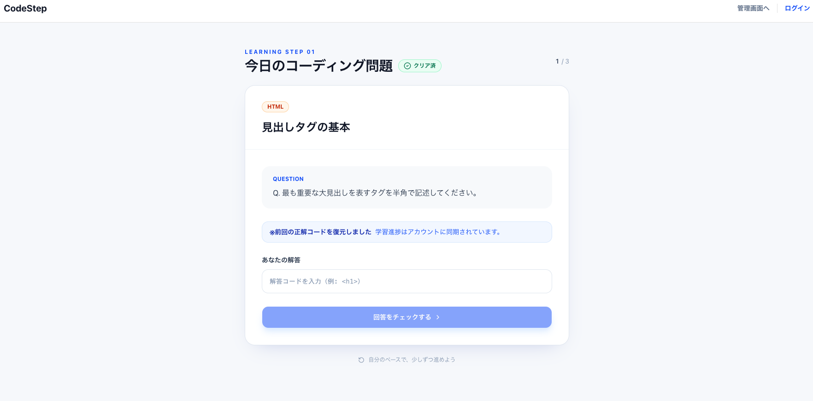

# CodeStep ポートフォリオ

## アプリ概要

CodeStepは、学習問題への解答と正誤判定を通して、プログラミング学習を進めるための学習アプリです。  
ユーザー登録・ログイン後に学習問題へ取り組み、管理画面では学習問題の作成・一覧表示・編集・削除ができます。

## サイトイメージ

## アプリURL

https://codestep-two.vercel.app

## アプリ本体GitHub

https://github.com/bonbabo108/codestep

## 使用技術

- Next.js
- React
- TypeScript
- Tailwind CSS
- Supabase
- Vercel
- GitHub

## 機能一覧

- ユーザー登録・ログイン機能
- 学習問題の表示機能
- 解答入力・正誤判定機能
- 学習進捗の保存機能
- 管理画面での問題作成機能
- 管理画面での問題一覧表示機能
- 管理画面での問題編集機能
- 管理画面での問題削除機能

## 設計ドキュメント

CodeStepの画面構成とデータベース設計を確認できる資料です。

| 種類 | 内容 | ファイル |
| --- | --- | --- |
| ワイヤーフレーム | ログイン画面、学習画面、管理画面の画面構成 | [wireframe.png](./docs/wireframe.png) |
| ER図 | profiles、questions、user_progress のテーブル構成 | [er-diagram.png](./docs/er-diagram.png) |

## テスト・修正の設計及び実施書

v0プレビュー内で、学習画面・問題管理画面・回答チェック機能の表示と動作確認を行いました。  
問題編集機能や回答判定の不具合を確認し、v0上で修正依頼を行ったうえで再確認しました。

## アプリ改善案

今後の改善案として、以下を検討しています。

- 管理画面のアクセス制御強化
- 問題カテゴリの追加
- 学習進捗の可視化
- 不正解時のヒント表示の改善
- ユーザーごとの学習履歴表示

## 生成AIツールの活用用途

- ChatGPT：要件整理、README作成、課題提出内容の整理
- v0：プロトタイプ作成、画面UIの確認
- Cline：README修正、ドキュメント整理
- GitHub Copilot / AI支援ツール：コード修正方針の相談

## 備考

このリポジトリは、CodeStepのポートフォリオ提出用リポジトリです。  
実際のアプリ本体コードは、上記の「アプリ本体GitHub」に格納しています。
